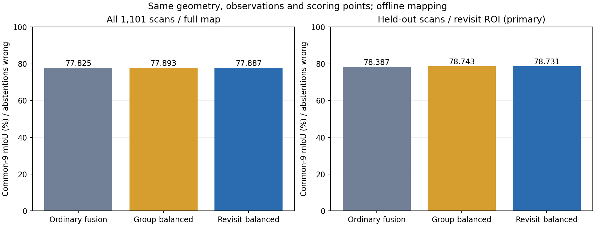
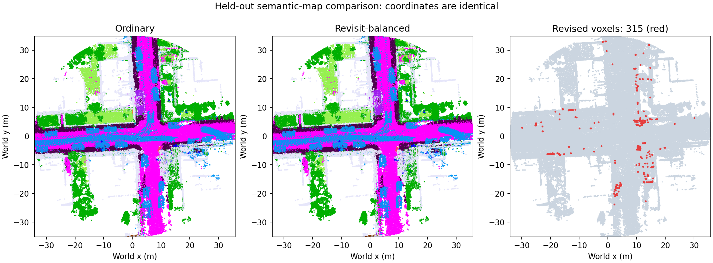
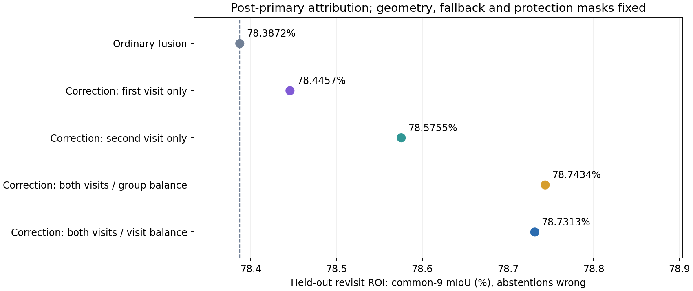

# 回访语义纠错：固定几何的对照实验

这项实验在已有几何回环之后更新语义标签。所有分支使用相同的已优化轨迹、原始点云、归档 B0 seed-1 预测和评估点。没有重新训练网络，也没有修改旧实验。它回答的是：**位姿固定之后，如何利用回访证据减少语义错误？**

## 已接入的处理

`tools/loop_semantics/fusion.py` 提供独立的 NumPy 融合模块，输入只有预测类别、置信度、几何位置、距离和帧号，不读取真值。

1. 每帧每个体素先取平均证据，减少近处点数较多造成的权重偏差。
2. 每五帧形成一组，组内再平均，避免连续几帧被简单当作多次完整投票。这是相关性抑制，不声称这些组在统计上独立。
3. 使用 `1 / (1 + (range / 20m)^2)` 为观察距离分配可靠性权重；这是事先设定的启发式，不是标定后的正确率。
4. 对已通过几何验证的回环，在两个端点各取前后 100 帧的访问窗口。在同一世界体素中，两个访问都至少有两组证据，且各自观测质心距离不超过 0.20 m，才允许合并。
5. 任何置信度过门限的人、车辆、两轮车或交通锥证据都会保护该体素，使它保留原融合结果。该保护不等同于已完成运动跟踪；真正移动但被模型误判成静态的物体仍是风险。
6. 新类别的证据份额至少 0.65，领先第二类至少 0.20，才改写标签；其余位置继续使用原结果。不会删除难点、增加评估空洞或移动地图点。

归档缓存只保留 top-1 类别和置信度。这里融合的是这些观测的证据直方图，**没有把它们伪装成完整 softmax 分布**；也不能从现有 16 类输出中凭空产生缺失的 SemanticKITTI 细类。

## 三个分支

| 分支 | 融合方式 | 用途 |
|---|---|---|
| `ordinary` | 原来的逐点置信度累加 | 必须精确重现已归档的回环后结果 |
| `group_balanced` | 按帧、按五帧组平衡，再累加两次访问的组证据 | 控制点密度和连续重复观察的影响 |
| `revisit_balanced` | 在上一项基础上，将每次访问的组证据取均值后融合 | 检查长时间、低质量的一次访问是否压过清晰回访 |

后两个分支使用相同的访问窗口、空间关联和保护条件。它们相互之间只改变访问次数的权重。与原融合相比，新增模块仅在经过这些检查的回访区域尝试修正。

本次固定使用序列 07 已通过验证的回环：历史帧 10、当前帧 1060。ROI 是两端点位置均值周围半径 35 m 的水平圆柱，由几何定义，与语义真值无关。参数在首次评分前提交到 Git，见 `tools/loop_semantics/protocol.json`。

## 评估与防止虚假收益

- 同时建立全帧地图，以及排除帧号尾数为 5 的留出地图。
- 留出帧的**预测和语义真值**都不参与留出地图构建。它们仍属于原 SLAM 轨迹的一部分，因此这不是独立场景测试或完全独立的几何评估。
- 主指标是在留出帧的回访 ROI 上计算固定 common-9 类均值 IoU，未回答的点按错处理；另报告完整序列、相机视野外及静态类区域。
- 所有地图先完成并记录哈希，再单独读取 GT 评分。每个分支的评估分母和没有地图回答的点必须相同。
- `ordinary` 的完整混淆矩阵必须与原来回环后归档结果逐项相等。
- 同时记录纠正点数、改错点数、错类之间的转换，以及没有改善的对照。不会只展示提高的类别。

这里使用整个轨迹的回访信息，属于**离线语义建图**。当前输出不能当作单帧榜结果，也没有声称已经接入实时 ROS 回环回调。若把这种一致性用于后续训练，必须另外在训练序列生成伪标签；不把本次评估序列的修正结果回灌训练。

## 已完成的主实验

[运行 40036755735](https://github.com/KaiFeng-Frank/rgb-semantic-livo-mapping/actions/runs/40036755735) 全部通过；[地图和证据 Release](https://github.com/KaiFeng-Frank/rgb-semantic-livo-mapping/releases/tag/loop-semantics-40036755735-1) 保留完整输出。[本仓库的小型证据](../results/loop_semantics_seq07_20261024/) 包括混淆矩阵、全部分支、参数和哈希。

| 范围，固定 common-9，未回答按错 | 原融合 | 按观察组平衡 | 再按访问次数平衡 |
|---|---:|---:|---:|
| 全帧地图，完整序列 | 77.8255% | 77.8927% | 77.8870% |
| 留出地图，全部留出帧 | 76.6820% | 76.7403% | 76.7385% |
| 留出地图，回访 ROI（预先声明的主指标） | 78.3872% | 78.7434% | 78.7313% |

主指标范围有 2,173,796 个有效 GT 点。按观察组平衡在该范围提高 **0.3562 个百分点**，整个序列全帧地图则提高 **0.0672 个百分点**。不能把局部收益写成全局收益。

在全部留出帧中，按观察组平衡纠正 7,040 个点，改错 349 个点，另有 30 个点从一种错误转成另一种错误。按访问次数平衡纠正 7,863 个点，但改错增加到 1,522 个，最终 mIoU 略低。该额外归一化没有显示出增益，不应仅因名称里有“回访”就优先采用。

这轮收益发生在静态语义，人、车、两轮车类别的 IoU 保持相同。两种新分支均达到与原融合相同的几何、覆盖率、评估分母；原融合完整混淆矩阵与历史归档逐项一致。

把几何回环和语义处理连起来，在同一完整点集、未回答按错的 common-9 口径下，全局地图为：无回环 **76.8382%** → 仅几何回环 **77.8255%** → 几何回环加按观察组平衡 **77.8927%**。其中约 0.9873 个百分点来自几何，约 0.0672 个百分点来自新增语义处理，两部分分别报告。





首次运行因 JSON 将 `0.20` 序列化为 `0.2` 而误触发参数字节比较，尚未读 GT 即停止。改为比较解析后的参数后重跑；两次构建的地图 SHA256 完全相同，融合方法和门限未变。

## 跨回访信息归因

主实验完成后，新增两个明确标记的诊断对照：纠错模块只使用首次访问的类别证据，或只使用再次访问的类别证据。保留同一份原地图、几何对应、动态保护和置信度门限，检查合并两次访问是否优于单次访问的纠错。这里“只用一次访问”限定于新增纠错模块；原地图后备输出仍来自全序列融合。

该检查直接恢复主实验的地图及分访问证据，不重建、不调整原有三种方法。原数组及原评分必须完全不变。代码在 `tools/loop_semantics/attribution.py`，并记录它是在主结果之后加入的诊断，不把它冒充预先注册的主实验。

[归因运行 40037646857](https://github.com/KaiFeng-Frank/rgb-semantic-livo-mapping/actions/runs/40037646857) 已通过全部检查，原地图数组和三组原评分保持完全一致：

| 新增纠错使用的语义证据 | 留出回访 ROI mIoU9 |
|---|---:|
| 不增加纠错，原融合 | 78.3872% |
| 仅首次访问 | 78.4457% |
| 仅再次访问 | 78.5755% |
| 两次访问，按观察组平衡 | **78.7434%** |
| 两次访问，额外按访问次数平衡 | 78.7313% |

合并两次访问分别比只用首次、只用再次访问高 **0.2977 / 0.1679 个百分点**。这支持本序列中存在跨回访语义证据的互补收益；并不证明任意场景都提高，也没有证明额外的访问等权有效。



[完整归因证据](../results/loop_semantics_attribution_20261024/) 与 [归因 Release](https://github.com/KaiFeng-Frank/rgb-semantic-livo-mapping/releases/tag/loop-attribution-40037646857-1) 保存全部结果。

## 当前采用的输出

当前离线建图建议采用 `group_balanced`，保留 `revisit_balanced` 和单次访问作为对照，不将更复杂的等权版本强行设为优选。这个选择来自本次可行性结果，跨序列泛化仍需另外验证。实时 ROS 节点的默认行为没有改变。

主实验 Release 的 `all-maps.npz` 就是可恢复的完整地图：`xyz` 和 `key` 在三个分支中共用，`ordinary`、`group_balanced`、`revisit_balanced` 分别为对应的 nuScenes-16 类别数组。使用改进语义时读取 `xyz` 与 `group_balanced` 即可。`heldout-maps.npz` 用于留出评估，不替代完整部署地图。

## 运行与恢复

```bash
python3 -m pip install -r tools/loop_semantics/requirements.txt
python3 -m unittest tools.loop_semantics.test_fusion -v
python3 -m tools.loop_closure.restore --root /tmp/revisit-inputs --out out/revisit
python3 -m tools.loop_semantics.run --root /tmp/revisit-inputs --out out/revisit --stage build
python3 -m tools.loop_semantics.run --root /tmp/revisit-inputs --out out/revisit --stage score
python3 -m tools.loop_semantics.package out/revisit
```

推荐手动运行仓库的 `loop-semantic-refinement.yml` 工作流，在临时 CPU runner 上恢复数据、建图和评估。普通推送只跑约束测试，避免每次文档修改都重新下载数据。归因检查使用 `loop-semantic-attribution.yml`。源码及小型结果保留在 Git，地图、证据数组和哈希保存到 Release，原始数据不回传本机。`build.json` 记录实际参与建图的帧，`comparison.json` 保存全部对照和误差变化；检查运行状态，不能把一个草稿 Release 的存在视为实验完成。

设计借鉴多视角语义融合的一般思路，例如 [SemanticFusion](https://arxiv.org/abs/1609.05130)。上述访问平衡与保护规则是本项目的待验证实现，不以“加了回环”或某个指标提高就宣称新的研究贡献。
