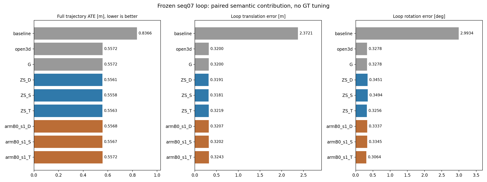
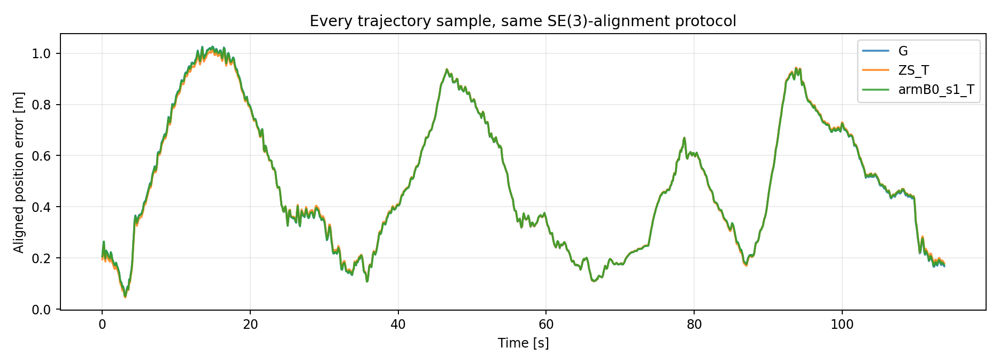

# 语义帮助位姿：链路已验证，首轮收益不足

语义预测现在能够通过配准权重改变回环相对位姿，再进入原有 GTSAM 位姿图。首轮固定协议实验已经完成，但结果不支持把这项改动作为明显的定位提升：B0 的最小 ATE 仅比纯几何低约 **0.506 毫米**，加入历史稳定性后仅低约 **0.036 毫米**。这些数值是轨迹 RMSE 的差，不代表系统具有毫米级定位精度。

本轮止于这项可行性验证，不据此扩大实验或修改实时 ROS 默认配置。

## 相同输入与完整对照

[固定协议](semantic_pose_protocol.md) 在评分前提交于 `f9e934d`；执行提交为 `c946f05bb1728ba48deec5807ba86f6fb8db0bee`。[完整运行 40120102173](https://github.com/KaiFeng-Frank/rgb-semantic-livo-mapping/actions/runs/40120102173) 成功，代码和结果在 [PR #4](https://github.com/KaiFeng-Frank/rgb-semantic-livo-mapping/pull/4)。

输入使用同一份 FAST-LIVO2 原始轨迹、历史帧 10 / 当前帧 1060 的既有回环、相同源点 9,468 个和目标点 17,519 个、相同去畸变与体素采样。这里固定的是**输入几何和算法条件**，优化后的位姿会改变。全部分支评分 1,096 个相同时间戳和 1,086 个相同的 1 s 相对位姿对。

G 为纯几何；D 加可能移动类别软降权；S 在 D 上加语义兼容性；T 在 S 上加历史重复观测稳定性。ZS 是原始零样本预测，B0 是本项目已有训练模型。没有重新训练、推理或门限搜索。

| 方案 | 全轨迹 ATE / m | 相对 G 的 ATE 变化 / mm | 回环平移误差 / m | 回环旋转误差 / ° |
|---|---:|---:|---:|---:|
| 原始轨迹，无回环 | 0.836592 | — | 2.372079 | 2.993355 |
| 原 Open3D 几何回环 | 0.557214 | 0.000 | 0.319985 | 0.327763 |
| 同求解器纯几何 G | 0.557214 | 0.000 | 0.319985 | 0.327763 |
| ZS + D | 0.556136 | −1.078 | 0.319080 | 0.345067 |
| ZS + S | 0.555798 | −1.416 | 0.318137 | 0.349390 |
| ZS + T | 0.556265 | −0.949 | 0.321850 | 0.325634 |
| B0 + D | 0.556808 | −0.406 | 0.320708 | 0.333688 |
| B0 + S | 0.556708 | −0.506 | 0.320158 | 0.334548 |
| B0 + T | 0.557178 | −0.036 | 0.324319 | 0.306418 |

负的 ATE 变化表示误差降低，但不能仅凭负号判定有实际价值。完整平移/旋转 RPE、留出静态回访距离和全部候选轨迹评分见 [comparison.json](../results/semantic_pose_seq07_20261025/comparison.json)。

## 这轮说明了什么

- **不是模块没有触发。** B0 的 D / S / T 分别对最终约 13.5% / 16.0% / 56.2% 的配准对应降权；六个语义候选全部通过固定门限，没有触发回退，确实产生了不同的相对位姿与最终轨迹。
- **不能把几何回环的主收益归给语义。** 0.836592 → 0.557214 m 发生在纯几何阶段。B0 的 D 已贡献约 0.406 mm 的微小 ATE 变化，额外语义兼容性的差额只有约 0.100 mm。
- **历史稳定性存在取舍。** B0 + T 的回环旋转误差从 G 的 0.327763° 降到 0.306418°，但平移误差从 0.319985 m 增到 0.324319 m，整体 ATE 基本不变。不能只展示旋转改善。
- **更好的分割没有在此转化成更好的定位。** 同一 D / S / T 下，B0 的 ATE 均略高于 ZS；本轮未验证“我们训练后的语义优于原始语义用于定位”。这也不证明 ZS 在其他序列更适合定位。
- **一个已知回环不足以证明普遍收益。** 当前测的是已通过几何验证的回环约束精化，没有测试误回环识别、持续局部定位或真实运动跟踪。该场景上的微小变化不支持进一步大规模跑参数。

后续若继续，应先验证明确的失效情形：几何配准被移动物体或跨物体对应牵引时，语义能否避免错误；同时保留几何采样/稳健核对照，区分语义信息和普通离群点抑制。短时停泊车辆的利用、因果局部后端与实时延迟处理仍需另行实现。这里没有把这些未来工作写成已完成。

## 验证与恢复

云端 **16 项测试通过**：7 项权重/求解/退化/回退核心测试，3 项体素中心、原始点索引和历史隔离测试，6 项原几何后端测试。原 Open3D 回环测量最大矩阵元素差为 `4.12e-14`；新求解器 G 与 Open3D 的平移差为 `1.08e-12 m`，并精确复现原 ATE。语义收益不是替换求解器造成的。

所有候选及最终轨迹先保存哈希，再由独立 evaluator 读取真值。既有评分、相同时间支持和 ZS/B0 输入几何完全相同的检查均通过。首次云端启动只因 Ubuntu 24.04 的 Python 3.12 没有固定 GTSAM 4.2 wheel 而失败；改回原几何实验的 Ubuntu 22.04/Python 3.10 后完成，参数和方法未变。

[完整 Release](https://github.com/KaiFeng-Frank/rgb-semantic-livo-mapping/releases/tag/semantic-pose-40120102173-1) 保存全部候选/采用轨迹、约 1.3 MB 的衍生配准输入、权重统计、图优化状态、环境版本和 SHA256。小型证据保存在 [results/semantic_pose_seq07_20261025](../results/semantic_pose_seq07_20261025/README.md)，下载文件逐一通过原 manifest 的 SHA256 检查。

原始点云只在临时 runner 恢复 25 帧，注册需要其中 6 帧，其余 19 帧用于留出几何诊断；原始数据和完整预测缓存不回传本机、不另行发布。复跑可手动触发 `semantic-pose.yml`；普通代码推送只跑测试，不重新下载实验数据。
