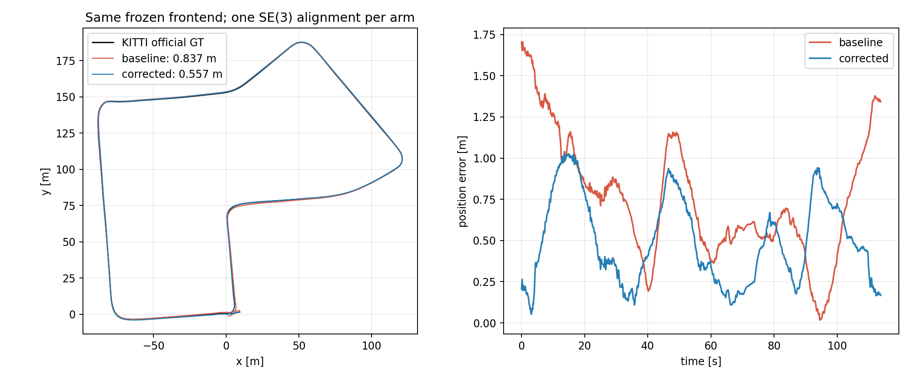
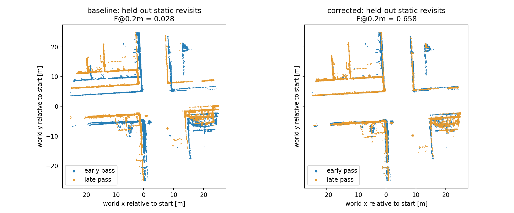

# Seq07: offline loop closure with unchanged B0 predictions

The paired run improves absolute trajectory accuracy, revisit alignment and
semantic-map fusion on KITTI sequence 07. Both arms use the same committed
FAST-LIVO2 trajectory and archived `armB0_s1_07_r1` point predictions. The second
arm adds geometric loop closure and rebuilds the map from scratch.

| Measurement | Original trajectory + B0 | Loop-corrected trajectory + B0 |
|---|---:|---:|
| Official KITTI ATE RMSE, 1096 poses | 0.836592 m | 0.557214 m |
| 1 s translational RPE RMSE | 0.097061 m | 0.096732 m |
| Held-out static revisit distance, symmetric median | 1.398448 m | 0.148075 m |
| Held-out revisit F-score at 0.20 m | 2.759% | 65.758% |
| Out-of-frustum single-scan mIoU-9 | 71.9124% | 71.9124% |
| Out-of-frustum map mIoU-9, abstentions excluded | 77.3175% | 78.5259% |
| Same map score, abstentions counted wrong | 76.7705% | 77.9571% |
| Complete point denominator, abstentions counted wrong | 76.6339% | 77.8147% |
| Out-of-frustum map `person` IoU, abstentions excluded | 67.6304% | 70.4110% |
| Map voxels at 0.20 m | 2694274 | 2633191 |

ATE decreases by **33.4%** and the map's headline mIoU rises by **1.2084
percentage points**. The single-scan confusion matrices are exactly identical;
the `person` map gain is a fusion effect, not a change to the segmentation model.
The baseline reproduces the archived voxel count, evaluated-point count and
scan/map mIoU exactly ([parity check](baseline-parity.json)).

## Trajectory and revisit geometry

ATE uses official KITTI odometry poses, raw camera timestamps and one global
SE(3) alignment per arm, with no scale. The older 0.880 m result elsewhere in
the repository uses SemanticKITTI reference poses and is a different reference.
Some individual trajectory portions worsen after optimization; the sequence
RMSE and maximum error improve. The 1 s RPE changes very little.

Blue is the early pass and orange is the late pass. Both panels use the same
fixed world region. The plotted scans end in frame index 5; backend keyframes
are multiples of 10, so these point clouds were excluded from loop registration.
Static building/fence/pole/sign labels are used only in this evaluator. No
additional transform is fitted for the revisit metric. This is a within-sequence
diagnostic, not a separate test dataset or a complete map-accuracy benchmark.

## Reproducibility and scope

- [Successful CPU workflow](https://github.com/KaiFeng-Frank/rgb-semantic-livo-mapping/actions/runs/40028387196),
  execution commit `3c2b7c48e39957e441a5ca6cccd3011c1be4f247`.
- [Frozen protocol](protocol.json), [accepted/rejected loops](loops.json),
  [full comparison](comparison.json), [baseline semantic evaluation](baseline_semantics.json),
  [corrected semantic evaluation](corrected_semantics.json).
- One accepted loop: frame 1060 matched historical frame 10. Ground-truth poses,
  semantic labels and network predictions never enter the backend.
- Six contract tests passed. The real odometry-only graph's maximum matrix-entry
  change is below 1e-12. Historical baseline parity and identical single-scan
  predictions passed independently.
- [Input recovery and hashes](input-recovery.json), [package versions and execution](execution.json),
  [asset manifest](manifest.json), [SHA-256 checksums](SHA256SUMS).
- [Full result release](https://github.com/KaiFeng-Frank/rgb-semantic-livo-mapping/releases/tag/seq07-loop-40028387196-1)
  contains both complete semantic maps (about 44 MB and 43 MB), keyframe poses,
  corrected/original IMU trajectories, figures and metrics. The map/keyframe NPZ
  files remain in the release; the compact evidence and trajectories are in Git.
  Raw KITTI scans and prediction caches were not republished or downloaded to
  the local workstation for this experiment.

This is one sequence, one frozen B0 seed/pass and an offline backend. It supports
adding loop closure to the mapper; it does not establish gains on other sequences
or online runtime. Semantic map scores query each arm in its own estimated
geometry, so their improvement complements rather than replaces the independent
official-GT trajectory evaluation. The complete-denominator score also counts
the partially unsupported points omitted by the legacy metric as abstentions.

Implementation, borrowed libraries and rerun commands:
[offline loop closure documentation](../../docs/offline_loop_closure.md).
