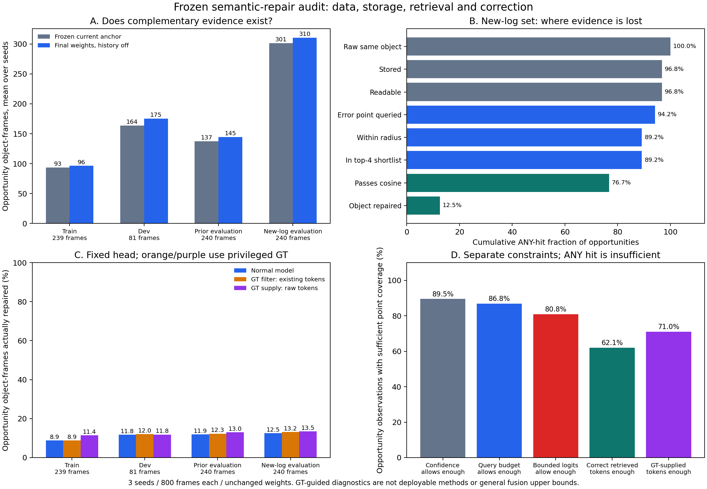
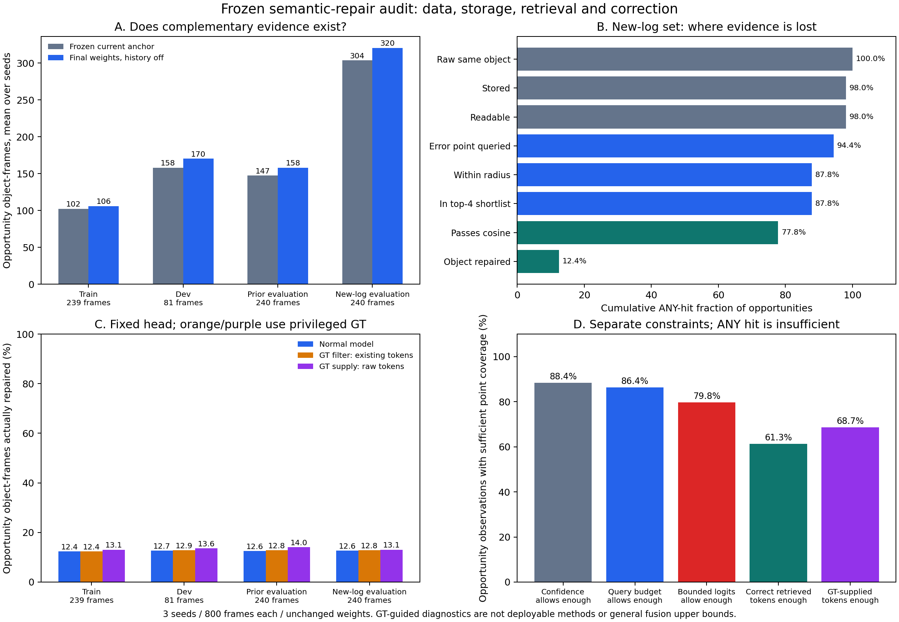

# 语义联合纠错：从数据机会到实际修复的逐级验证

**有可纠错的序列，但当前方法没有充分利用这些机会，训练覆盖也不均衡。**
这次检查覆盖训练、开发、回归和后续确认四个分区，而不只检查最终指标。
另外发现并修复了 PTv3 随机开关未传到池化层的问题；更严格的跨进程复现
检查仍失败，原始失败记录一并保留。

## 口径与控制

- 同一批 20 段真实 nuScenes 序列，800 个标注关键帧；训练 239、开发 81、
  回归 240、后续确认 240。分区继承原实验，没有根据本次结果重新挑选序列。
- 使用三个已经选定的权重版本（seed 0/1/2）；冻结骨干、当前帧锚点和融合头。
  没有优化器、再训练、参数搜索或重新选择 checkpoint。
- 每个设置下，各方法共用同一份提取缓存。逐帧比对带诊断钩子的正常模型与
  原模型，要求输出、查询索引、记忆坐标与概率完全相同；检索归因也核对实际
  候选特征、坐标差和有效掩码。
  两种特征策略各完成 2,400 次检查，共 **4,800 次通过**。
- “机会”指当前帧 **同一融合权重关闭历史后**，某 GT 实例少于 50% 的有效
  目标点分类正确，而紧邻上一帧原始 B0 对同一实例至少 50% 分类正确。
  同时统计加入新融合头之前的冻结当前帧锚点，检查机会是否只是新头遗忘造成。
- 一个目标在多个帧出现会重复计数；三个 seed 重用同一批扫描。
  **这些是目标帧观测次数，不是独立样本数，也不是检出延迟。**
- GT 类别、框和实例 ID 只供离线诊断。正常推理不接收它们，不读取未来帧，
  不把纠错后的结果写回历史。包含多个实例或未归属标注点的体素不作确定身份匹配。

## 保留原特征策略时，机会在哪里丢失

主诊断保持训练时的“根序列化关闭、池化随机排列开启”策略，重新构建共享缓存。
与上一轮单独提取确认集的数字有差异，原因包括下文实证的顺序依赖；不覆盖旧结果。

| 分区 | 当前帧锚点的机会，seed 0/1/2 | 最终头关闭历史的机会 | 正常历史实际修复 | 正确历史覆盖足够错误点 |
|---|---|---|---|---|
| 训练 | 90 / 96 / 94 | 89 / 116 / 84 | 4 / 16 / 7 | 26 / 42 / 22 |
| 开发 | 154 / 169 / 168 | 158 / 202 / 166 | 9 / 26 / 28 | 121 / 162 / 128 |
| 回归 | 131 / 137 / 144 | 144 / 154 / 136 | 11 / 17 / 23 | 57 / 67 / 55 |
| 后续确认 | 288 / 295 / 321 | 287 / 349 / 295 | 26 / 50 / 42 | 166 / 235 / 180 |

最后一列表示：已有正确、同实例的历史候选送达足够多的当前错误点，若这些点
都被正确修复且其他点不受损，就能达到目标识别阈值。**这不保证融合头能做到，
也不是任意融合方法的性能上界。**

确认集的逐级 ANY-hit 比例（三个 seed 各自计算后取均值）：正确历史存下来了
96.8%，至少一个错误点能取得正确候选 76.7%，实际完成目标修复 12.5%。
更严格的“正确候选覆盖足够错误点”比例为 62.1%。其中 140 / 185 / 138 次
虽然覆盖足够，最终仍没修复成功。存储、检索都有损失，但不能把主要剩余问题
简单解释为“正确证据都没取到”。ANY-hit 漏斗不能证明某阶段保留了足够点数。

还有明确的结构限制：每类修正被限制在 ±2，因而最多改变约 4 的类别 logit 差；
再加上固定置信度筛选和查询预算，仅 80.8% 的确认集机会在这些约束下具有
足够可改正的错误点。这个比例只表示必要覆盖条件，不表示模型实际会改对。

## 让正确证据直接进入现有头，会怎样

固定所有权重、正常查询集合、时间限制、实际类别相关半径和余弦门槛，增加两个
**使用 GT 的特权诊断**：

1. `clean_existing_gt`：在已归属 GT 目标的查询点上，只留下正确且同实例的历史候选。
2. `supply_raw_gt`：对有机会的目标，绕过存储压缩和候选预筛选，从上一帧原始点中
   补入正确同实例的特征及原始概率；保留上述查询、年龄、半径和余弦约束。

不注入 GT 类别 logits，不改变当前帧输出分支，不额外训练。GT 仅决定诊断候选。
这些是条件反事实测试，**不能作为可部署模型，也不是一般意义的 oracle 上界**。

确认集正常修复 **26 / 50 / 42** 次，GT 筛选后 **27 / 53 / 44** 次，
GT 原始证据补入后 **28 / 55 / 44** 次。补入后的覆盖条件本身改善，但目标修复
只小幅变化。说明在这组固定头和约束下，仅改善历史候选不足以解决主要剩余错误；
不能据此进一步断定是网络容量、目标函数或训练采样中的哪一个单独造成。

对于已经收到正确候选的当前错误点，正确同实例历史所占注意力权重的目标帧均值，
三个 seed 为 91.0% / 93.1% / 92.7%。这是**命中条件下**的统计，不代表全局
检索准确率。它也不支持把主要剩余失败简单归因于正确证据始终被注意力压低。

也检查了损害：在确认集全部目标观测上，相对相同权重关闭历史，正常历史修复
30 / 54 / 49 次，同时把原本正确的目标改错 34 / 35 / 41 次。
因此只报条件修复率会遗漏代价。

## 训练覆盖是否足够

训练确实包含互补信息：冻结当前帧锚点已有 90 / 96 / 94 次机会，说明并非只在
最终头的错误上才产生这种现象。但最终头的训练机会主要集中在汽车和卡车，
涉及的不同实例仅 50 / 56 / 48 个；**行人每个 seed 只有 5 个目标帧机会，
来自 4 个不同实例**。对应确认集的行人机会为 58 / 50 / 48 次。

当前头的训练损失覆盖普通查询点，并未专门保证这些稀缺互补错误得到足够监督。
现有数据支持优先检查训练中的互补错误覆盖、历史可用性和保留正确输出的约束，
还不支持单凭总帧数扩训或加大注意力模块。训练集与评估集均已有检查痕迹；
任何后续依此修改的模型都需要另外的确认数据，不能把这里再当全新留出集。

## 随机开关修复与复现失败

Pointcept v1.5.1 的四个 `SerializedPooling` 在构造时独立默认
`shuffle_orders=True`；骨干上的 False 没有传进去，`.eval()` 也不禁用其中
的 `torch.randperm`。现在加载器把显式开关传播到所有相关模块，特征指纹记录
每层有效值，旧指纹的历史模型不能悄悄接收新特征。严格权重加载保持不变。

[真实扫描探针](serialization-probe.json)按索引事先选定首、中、末三段序列，
预热后执行 A-A 和 A-B-A：旧策略每次改变 307–626 个体素类别；全关闭策略的
六次比较中，特征与 logits 均完全一致，且不消耗 CPU 随机数。

随后另起进程，换随机种子并反转全部 800 帧顺序，结果是：

- 坐标、体素逆映射全部一致；没有消耗 CPU 随机数。
- 27,775,488 个点中，6,672 个标签不同，比例 **0.024021%**。
- 17,649,081 个体素中，2,063 个类别不同；特征和 logits 均未达到逐帧位级一致。
- logits 最大绝对差 0.125；特征最大绝对差 0.0859375。

**更严格的复现检查失败。** 剩余差异的来源尚未隔离；只能确认随机开关漏洞已修，
不能宣称跨进程全面确定性。保留 [完整结果](reverse-order-check.json) 和
[失败日志](reverse-order-check.log)，后续所有方法对照仍固定共用同一份缓存。

## 修复开关后，冻结权重重放的结果

使用全部序列重新提取的全关闭缓存，重复同一套链路诊断。
**这是一项特征策略敏感性检查**：三个头仍是旧策略训练所得，没有把新特征
假称为原训练合同，也没有重新训练、选择或给模型授予部署资格。

| 分区 | 机会，seed 0/1/2 | 正常历史修复 | GT 筛选修复 | GT 原始证据补入修复 |
|---|---|---|---|---|
| 训练 | 100 / 121 / 97 | 6 / 19 / 15 | 6 / 19 / 15 | 6 / 19 / 17 |
| 开发 | 149 / 195 / 167 | 12 / 27 / 27 | 12 / 27 / 28 | 12 / 30 / 29 |
| 回归 | 150 / 172 / 152 | 14 / 24 / 22 | 14 / 24 / 23 | 14 / 27 / 26 |
| 后续确认 | 299 / 353 / 309 | 31 / 47 / 44 | 31 / 50 / 43 | 32 / 48 / 46 |

确认集正确历史覆盖足够错误点的次数是 175 / 229 / 187，其中
**144 / 183 / 144 次仍没有修复成功**。全部目标观测的修复/损害分别为
34/33、55/24、50/36。训练中的行人机会仍只有 5 / 4 / 4 次。
两套提取策略都支持“覆盖不足且可用证据未充分转化为纠错”的诊断。

同预算当前帧控制与时序模型的点 mIoU 均保存，没有用反事实诊断替代正式对照：

| 特征策略 | 回归：当前帧控制 / 时序 | 后续确认：当前帧控制 / 时序 |
|---|---|---|
| 旧策略本次重建缓存 | 51.769 / 51.869 | 56.929 / 56.870 |
| 所有随机排列关闭 | 51.097 / 51.051 | 57.066 / 57.005 |

这是三个 seed 的均值；小样本、已检查的场景及冻结旧头不支持新的泛化优势声明。
完整分区、类别、不同实例数和按固定规则选取的失败实例见 [comparison.json](comparison.json)。

## 证据与范围

- [旧策略冻结诊断协议](legacy/run/protocol.json)、[逐 seed / 分区结果](legacy/run/summary.json)。
- [关闭随机排列后的协议](all_off/run/protocol.json)、[逐 seed / 分区结果](all_off/run/summary.json)。
- [归档复核](validation.json)重新计算了 24 个分区结果的目标统计和点指标，并
  检查源文件、权重、索引及缓存清单哈希。两份约 3.08 GiB 的临时特征缓存均已
  清理，保留提取清单与清理记录；原始数据未移动或删除。
- 每个 `seed-N/分区/` 包含逐帧一致性结果和压缩目标观测记录；候选归因代码与
  当时源文件快照、索引、提取清单及哈希均保存。
- 这些是 nuScenes 原生 16 类、本机 GPU 上的冻结头诊断；不代表 SemanticKITTI
  19 类榜单结果。使用原始关键帧和官方刚性位姿对齐，未做去畸变；约 2 Hz 的
  标注采样不能衡量驾驶中的语义响应延迟。
- 诊断工具有额外身份关联和比较开销，**本次不报告实时性准入**。
  也不把 GT 筛选/补入的结果写成研究方法成绩。
- [工程回归日志](tests.log)：71 项测试，70 通过，1 项因 PTv3 解释器没有 ROS
  消息包而跳过；包括因果候选、来源身份、混合体素排除、诊断不改变推理，以及
  递归开关和特征指纹检查。这些通过不替代上面的真实数据效果检查。
