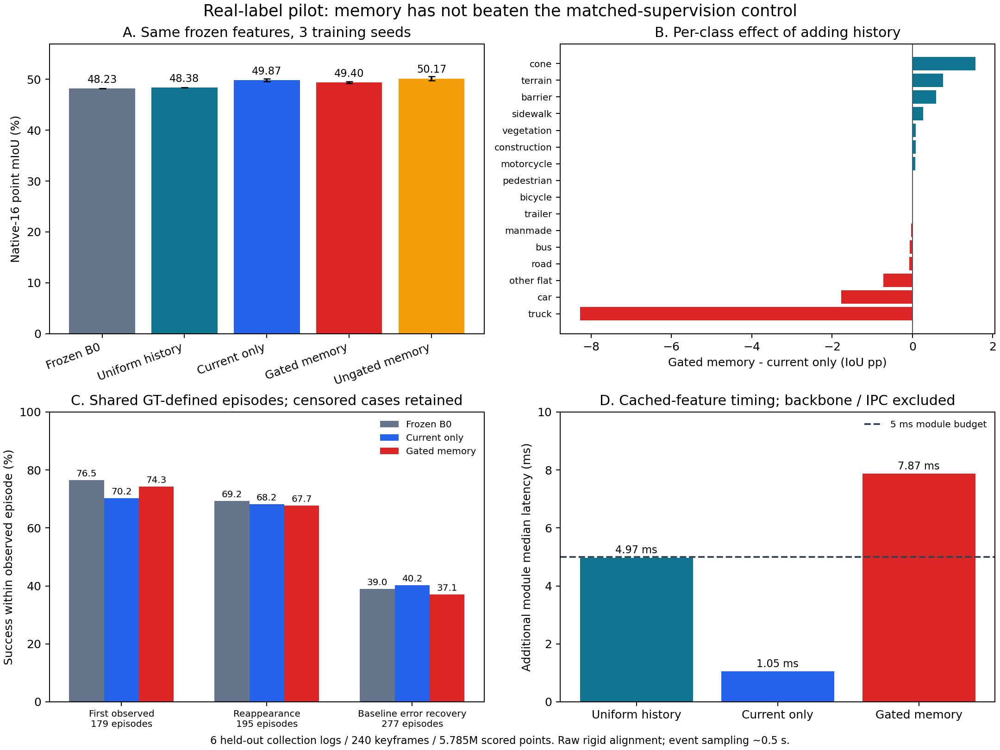

# Real-label semantic-memory pilot — not admitted

**结论：真实数据对照已完成。这版带门控的历史记忆没有超过同等监督的单帧控制组，
目标重现与错误恢复也没有改善，暂不进入默认推理链路。**

This is an actual labeled nuScenes experiment, not the earlier synthetic or
fixed-scan engineering check. The gated method improves over frozen B0 but does
not establish value beyond additional supervised current-frame learning. Its
5 ms module-overhead budget also fails. All trained heads remain non-deployable.



## Frozen comparison

One strict B0 backbone forward per scan provides identical features/logits for
every arm. The backbone is never trained here. The native16 mapping follows the
[nuScenes lidarseg taxonomy](https://www.nuscenes.org/lidar-segmentation) and the
existing Pointcept loader; raw intensity is divided by 255 with extractor scale
1.0. These scores are not the earlier KITTI common-9 metric.

Six official training scenes (239 keyframes) train the added heads. Two other
official training scenes (81 frames) select checkpoints. Six official validation
scenes (240 frames) are scored after all training and selection. All 14 scenes
come from different collection logs. Selection hashes log tokens before reading
labels/predictions; it does not select easy clips or favorable classes.

The evaluation contains 8,332,192 raw points; **5,784,962 nonignored points** enter
the confusion matrices. Predictions are scattered back through the voxel inverse
index and scored against original point labels. All 16 classes have nonempty
evaluation unions. No SemanticKITTI heldout is repurposed as training data.

| Arm | Additional supervision | Point mIoU, mean ± seed SD |
|---|---|---:|
| Frozen B0 | None | 48.23 |
| Uniform historical probability mixture | None | 48.38 |
| Current-only control | Official training labels | **49.87 ± 0.25** |
| Gated semantic memory | Same official training labels | **49.40 ± 0.19** |
| Ungated temporal candidate, inference ablation | Same trained temporal head | 50.17 ± 0.37 |

Three fixed seeds, five epochs, Adam 1e-3, four-frame clips. Current-only and
temporal heads share the same fusion parameterization and initial parameter
values. Current-only receives one **current** observation token, never history.
Both optimize identical supervised frames: 233 frames and 60 optimizer steps per
epoch; the first scan of each training scene initializes history and is excluded
from both objectives. Temporal training uses 0.15 history dropout and 0.15 history
corruption; current-only has no historical perturbation. Thus supervision and
training budget are matched, while the temporal regularizer remains part of the
proposed method. No checkpoint or gate threshold is selected on held-out scores.

The gated-minus-current mIoU differences for seeds 0/1/2 are -0.483, -0.399 and
-0.535 pp; mean **-0.472 pp**. A paired bootstrap over the six scenes, averaging
seed differences, gives a 95% interval **[-0.946, +0.267] pp**. This does not prove
population-level inferiority, but provides no evidence of the required superiority.
Individual points are not treated as independent statistical replicates.

## Functional outcomes, beyond aggregate mIoU

Evaluation-only GT boxes and instance IDs define object observation episodes.
An object is observed when at least five uniquely assigned points inside its box
have its GT semantic class. Success means at least half of those points are
classified correctly. Ground-truth boxes/IDs never enter feature extraction,
retrieval, memory, or a prediction head.

Scene-start tracks are left-censored and excluded from first-observation events.
Reappearance means a gap in labeled observations; it is **not** asserted to be
physical occlusion. Error recovery uses the same baseline-error episodes for all
arms. Failed/censored cases remain in success-rate denominators; conditional
delay and delay capped at a common episode horizon are retained separately.
Events are sampled at roughly 0.5-second labeled keyframes, not millisecond
inference response times.

| Success within the observed episode | Frozen B0 | Current-only | Gated memory |
|---|---:|---:|---:|
| First observed, 179 episodes | 76.54% | 70.20% | 74.30% |
| Reappearance after an observation gap, 195 | 69.23% | 68.21% | 67.69% |
| Baseline-error recovery, 277 | 38.99% | 40.19% | 37.06% |

Values average the three learned seeds; event definitions/counts are fixed.
Memory's first-observation success exceeds the newly trained current-only head,
but remains below frozen B0. Reappearance and recovery do not improve. A higher
mIoU alone would therefore not satisfy the functional research objective.

## What the diagnostics establish

- Removing gate attenuation/thresholding raises temporal mIoU from 49.40 to
  50.17 on average, but does not improve the episode outcomes enough to establish
  recovery benefits. This ablation was evaluated on the already selected weights;
  it is not a newly validated deployment configuration.
- The largest gated-versus-current class losses are truck **-8.28 IoU pp** and
  car **-1.78 pp**. Gains include cone +1.56, terrain +0.76 and barrier +0.58 pp.
  Pedestrian is almost unchanged: 53.77% versus 53.78%; these data do not support
  a pedestrian-improvement claim.
- The frozen seed-0 diagnostic finds historical eligibility for 38.5% of GT
  truck points, 51.5% of pedestrian points and 78.1% of car points. These are
  coverage observations, not proof that motion alone caused the losses.
- For seed 0, the full candidate repairs 83,199 baseline point errors and
  introduces 35,099. The applied gate/residual repairs 67,048 and introduces
  26,028: it prevents some errors but sacrifices more repairs. The hard threshold
  alone blocks 4,802 potential repairs and 2,640 potential harms; soft attenuation
  contributes to the remaining difference. Loss-improvement supervision has not
  delivered the desired class-balanced and recovery behavior in this pilot.

The immediate implication is to reconsider selection targets and usable history
for objects before scaling training. Simply increasing attention size, epoch
count or dataset volume is not justified by this result.

## Cost and geometry limits

The current-only head adds about **1.05 ms** median. Gated memory medians are
**7.83 / 7.80 / 7.97 ms** for the three seeds; p95 is 9.14–9.30 ms. Uniform history
is about 4.97 ms median. These are synchronized GPU module timings on cached real
features, excluding the backbone, transport and loading; they are not end-to-end
driving latency or a sustained 10 Hz admission test.

The pilot uses **raw keyframes rigidly aligned by the provided ego poses**;
per-point deskewing is not demonstrated. The same alignment is used for all
historical arms. Label sampling at 2 Hz is a limitation for fast-moving-object
association with a 0.5 m retrieval radius. This experiment can test the implemented
pipeline under that declared condition; it does not establish performance on a
deskewed 10/20 Hz deployment stream.

## Reproducibility and artifacts

- [Frozen protocol and source hashes](run/protocol.json),
  [selected frame identities and split](selected-frames.json),
  [feature hashes](feature-manifest.json), [training/evaluation log](train-eval.log).
- [Primary summary](run/summary.json), [aggregate table data](aggregate.json),
  [seed 0](run/seed-0/evaluation.json), [seed 1](run/seed-1/evaluation.json),
  [seed 2](run/seed-2/evaluation.json), [post-hoc gate diagnosis](run/gate-diagnostic.json).
- Each seed directory includes both trained fusion heads, per-epoch metrics,
  frame diagnostics and per-object correct fractions. Checkpoint selection uses
  dev mIoU: temporal epochs 4/5/5; current-only epochs 5/5/5. Each checkpoint's
  provenance records `scope=real_pilot`, `deployable=False`; the files themselves
  are PyTorch `.pt` archives. The online worker rejects them for active operation.
- [PNG](comparison.png) and [SVG](comparison.svg) figures. No raw point cloud,
  per-point annotation, original backbone weight or feature cache is committed.

The 560 frozen feature files occupied 2.13 GiB in a temporary RAM filesystem.
Training and evaluation took about 99 seconds after cache verification. The
cache is disposable and removed after diagnostics; the dataset stays untouched.
The modest runtime is enabled by reusing frozen features, not training PTv3.

```bash
# Configure PTV3_POINTCEPT, PTV3_CONFIG and PTV3_CHECKPOINT as in the main guide.
$PTV3_PYTHON -m tools.semantic_memory.nuscenes_pilot_data --out /path/to/new-pilot
$PTV3_PYTHON -m tools.semantic_memory.nuscenes_pilot_cache \
  --index /path/to/new-pilot/index.json --cache /dev/shm/new-feature-cache
$PTV3_PYTHON -m tools.semantic_memory.nuscenes_pilot \
  --index /path/to/new-pilot/index.json --cache /dev/shm/new-feature-cache \
  --out /path/to/new-pilot/run
$PTV3_PYTHON -m tools.semantic_memory.pilot_diagnose \
  --index /path/to/new-pilot/index.json --cache /dev/shm/new-feature-cache \
  --checkpoint /path/to/new-pilot/run/seed-0/temporal.pt --out /path/to/diagnostic.json
$PTV3_PYTHON -m tools.semantic_memory.plot_pilot \
  --run /path/to/new-pilot/run --out /path/to/new-pilot/figures
$PTV3_PYTHON -m unittest tools.semantic_memory.test_pilot_metrics -v
```

The dataset adapter uses the existing local nuScenes manifests and devkit split
definitions (paths at the top of the module). Source scan/label hashes are checked
before extraction. Feature caches are checked before optimization. Six focused
metric tests cover ignored labels, point-level scatter, box-axis conventions,
ambiguous membership, shared event definitions and censoring.
