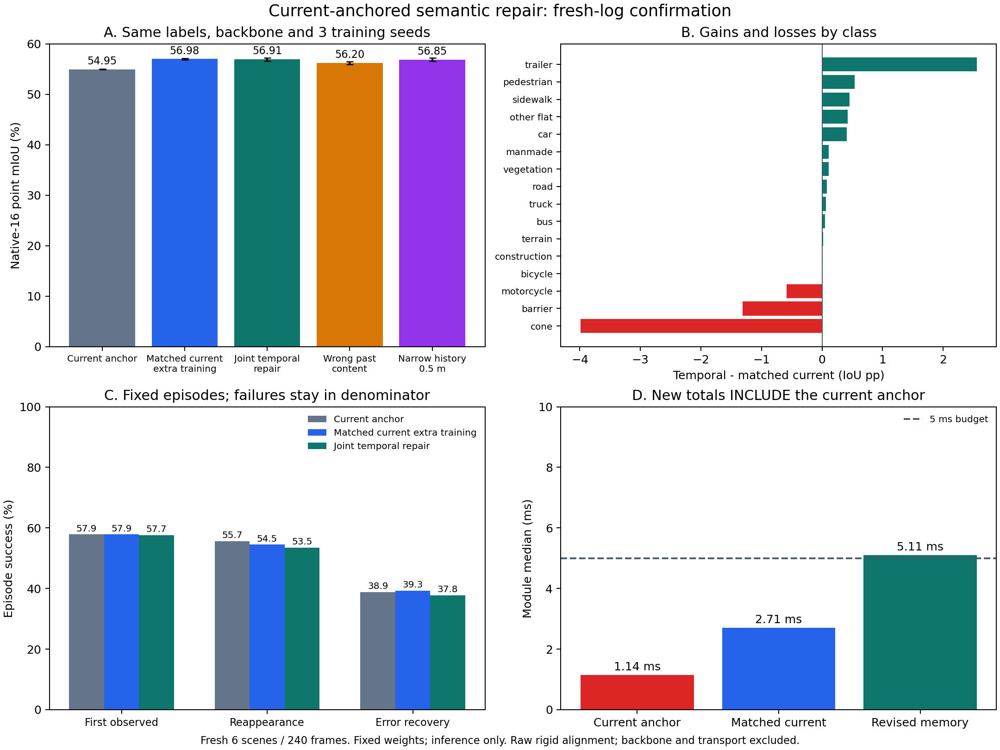

# Current-anchored semantic repair: implementation and real-data validation

已完成两轮结构修改、真实标签训练和独立新场景验证。**新版仍未通过准入。**
此前的历史门控已替换为当前/历史联合纠错；同预算控制组、历史关闭/打乱/缩窄
消融及全部训练权重均已保存。下面区分已用于开发分析的回归集与新采集场景确认集。

后续[完整链路验证](../chain_audit/README.md)定位到稀缺互补错误的训练覆盖不足，
以及正确历史送达后仍未修复的情况；还发现骨干的关闭随机排列设置没有传给
池化层。本页保留修复前策略的训练与结果，修复后的冻结权重敏感性重放另行保存。

## What changed

Implementation: [semantic_repair.py](../../../src/semantic_repair.py).

- A frozen, independently trained current-frame head is the anchor, rather than
  reverting to the original B0 whenever history is absent.
- The new correction head reads current features, historical features, their
  difference, current probabilities, probability differences, age and geometry.
  Its correction is bounded by `2*tanh`. There is no CE-utility binary gate or
  training/inference gate-threshold mismatch.
- Missing history uses a current token through the same trainable head. **This
  matters:** the first revision retained the anchor but still suppressed all
  additional learning at points without history. The final revision fixes that.
  Disabling history therefore returns the learned current path, not necessarily
  the unchanged frozen anchor. Zero initialization starts at the exact anchor.
- The objective combines training-class-weighted CE, wrong-class margin repair
  and preservation of the correct-class margin. Both learned arms use it.
  These are training penalties, not a guarantee of preserving heldout predictions.
- At most 4,096 queries are selected from anchor confidence below 0.9. The same
  query indices are available to both learned arms. Confident mistakes outside
  this selection remain uncorrected.
- Current top-two classes that may move allow a 1.5 m history search; other
  queries use 0.5 m. A vacated old position does not revoke a possibly moving raw
  observation. Static free-space contradiction still revokes static evidence.
- History contains only the previous raw scan, expires after 0.75 s, and keeps
  one representative per predicted class/cell, capped at four per cell and
  16,384 overall. Corrected features/logits are never written back.

The wider search is **not object tracking or motion compensation**. Similar
features and spatial proximity do not establish instance identity. A single
previous scan also cannot carry an object through a long observation gap.

## Comparison protocol

Frozen protocol: [run/protocol.json](run/protocol.json).

- Same 6 training scenes / 239 frames and 2 development scenes / 81 frames as
  the earlier pilot; official native-16 labels, frozen B0 backbone.
- Three seeds (0, 1, 2). Each starts from its earlier 5-epoch current-only head.
  Both new heads receive **the same additional five epochs**, initialization,
  parameter count, loss, query budget and selected training frames: 233
  supervised frames and 60 optimizer steps per epoch. First frames initialize
  history only for both arms.
- Training-class frequencies are computed only from training voxels. GT boxes
  and instance IDs are used only by the evaluator, never by the optimizer or
  model. No future frame is read into history.
- Checkpoint selection uses development point mIoU, separately per arm/seed.
  All three seeds finish training and selection before scoring the regression set.
- All arms share one frozen-backbone extraction per scan. Regenerating the
  cache changes B0 regression mIoU slightly, 48.23262 to 48.23404; the regenerated
  cache is shared by both revisions and all their controls. It is not claimed
  to be bit-identical to the earlier pilot cache.
- The earlier six evaluation scenes informed the redesign and are explicitly
  a **regression set**, not a fresh holdout.
- A further **six independent collection logs / 240 frames** were selected by
  the same pre-existing hash order, excluding every prior train/dev/test log,
  before their metrics were read. Fixed final weights were applied once to all
  three seeds. No retraining, threshold search or selection used this set.
  Selection: [confirmation/selected-frames.json](confirmation/selected-frames.json).

## Results

Mean native-16 point mIoU (%), three seeds:

| Method | Regression: prior 6 scenes | Confirmation: fresh 6 scenes |
|---|---:|---:|
| Frozen B0 | 48.23 | 54.26 |
| Frozen trained current anchor | 49.87 | 54.95 |
| Matched current-only extra training | **51.77 ± 0.12** | **56.98 ± 0.15** |
| Final joint temporal repair | **51.87 ± 0.24** | **56.91 ± 0.32** |
| Same temporal weights, current token only | 51.77 | 56.70 |
| Same temporal weights, shuffled past content | 51.65 | 56.20 |
| Same temporal weights, narrow 0.5 m search | 51.86 | 56.85 |

The final temporal-minus-matched-current difference is +0.094 pp on regression
and **-0.067 pp on fresh logs**, with a paired scene-bootstrap 95% interval
**[-0.140, +0.159] pp** on the fresh set. This does not establish superiority.
It also does not establish population-level inferiority.

The final model uses historical content: removing it or replacing it with
unrelated past content reduces its own point mIoU. That is weaker evidence than
outperforming a separately trained, equally supervised current-only model.
Most of the gain over B0 is also achievable by additional current-frame training.

Shared GT-defined object episode success (%), fresh logs:

| Event | B0 | Current anchor | Matched current | Temporal repair |
|---|---:|---:|---:|---:|
| First observed | 62.58 | 57.87 | 57.87 | 57.67 |
| Reappearance after observation gap | 57.51 | 55.65 | 54.51 | 53.51 |
| Baseline error recovery | 40.55 | 38.88 | 39.33 | 37.81 |

Failures/censored episodes stay in the denominator. A gap in labeled observations
is not proof of physical occlusion. Event times are quantized by the approximately
0.5 s labeled keyframe interval. The useful-object behavior has **not improved**,
including for the stronger current-only head despite its higher point mIoU.



## Both development attempts are retained

The first repair implementation scored 50.55 versus 51.77 for its matched
current control. It still disabled new-head learning without history. Its
weights, logs, protocol, source snapshots and results are under [attempt1](attempt1).

Fixing that structural omission raised the temporal result to 51.87 on the
same regression cache, with the control staying at 51.77. This comparison also
includes a vectorized class-membership implementation; no hyperparameter or
training-budget change was made between these two attempts. See
[regression figure](regression-figures/comparison.png) and [final run](run).

This development history is not a collection of independent confirmation tests.
The fresh confirmation above evaluates the final preselected version only.

## Runtime and status

The prior gated memory median was about 7.87 ms. The final revision is about
**5.08 ms on regression**, including the current anchor; fresh-log per-seed
medians are **5.10 / 5.12 / 5.11 ms**. It still fails the strict 5 ms budget.
The final matched current-only path is about 2.66 ms on regression including
the anchor. Measurements synchronize the GPU and exclude backbone extraction,
loading and transport. They are not end-to-end driving latency.

The input is raw nuScenes keyframes rigidly aligned by provided ego poses, not
verified per-point deskewed scans or a live estimated-pose stream. All heads are
marked `deployable=False`; the production ROS worker is unchanged and cannot
activate this new checkpoint schema. There was no remote server or new data
download. Work ran on the local RTX 5070 Ti Laptop.

**Admission remains false:** no established mIoU superiority, worse recovery
outcomes, and the module budget is still exceeded. The repaired implementation
and stronger current control are preserved for review; these results do not
justify enlarging the attention module, scaling training or enabling deployment.

## Verification and reproduction

[Validation checks](validation-checks.json): 169 tests passed, 1 ROS-import test
skipped in the PTv3 interpreter, and 128 parameter subtests passed. New tests
cover current fallback and gradient flow without history, moving observations
after their old position becomes empty, static revocation, expiry, class
representatives, raw-only writes, query bounds, causality and repair loss.

Training source snapshots match protocol hashes; all scored checkpoint hashes
match saved weights. Confirmation weights are byte-identical to the selected
regression weights. Frame counts and optimizer steps match between learned arms.
Raw scans, labels and multi-gigabyte feature caches are excluded from Git.

From the repository root, with the same PTv3 environment and original index:

```bash
$PTV3_PYTHON -m tools.semantic_memory.repair_pilot \
  --index /path/to/original-pilot/index.json --cache /dev/shm/revision-features \
  --anchors results/semantic_memory_20261025/real_pilot/run --out /path/to/new-repair-run
$PTV3_PYTHON -m tools.semantic_memory.repair_confirmation prepare \
  --old-index /path/to/original-pilot/index.json --out /path/to/new-confirmation
# Extract confirmation/index.json with nuscenes_pilot_cache using the same
# PTV3_POINTCEPT, PTV3_CONFIG and PTV3_CHECKPOINT environment as the original pilot.
$PTV3_PYTHON -m tools.semantic_memory.repair_confirmation score \
  --index /path/to/new-confirmation/index.json --cache /dev/shm/confirmation-features \
  --models /path/to/new-repair-run \
  --anchors results/semantic_memory_20261025/real_pilot/run \
  --out /path/to/new-confirmation/run
$PTV3_PYTHON -m pytest -q tools/semantic_memory/test_repair.py \
  tools/semantic_memory/test_pilot_metrics.py
```

The source snapshots under each training run use `.snapshot` suffixes to avoid
accidental Python imports or duplicate test discovery. First-attempt snapshots
preserve the earlier behavior; the current source implements the final revision.
