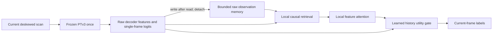

# Causal semantic memory

This experimental module learns when **recent raw observations help the current
point-cloud segmentation**. It reads the existing PTv3 decoder features from one
backbone forward. It adds no pose-estimation residual and changes no LIVO frontend.

The implementation, cache exporter, training/evaluation CLI and opt-in ROS adapter
are available. A [real-label nuScenes pilot](../../results/semantic_memory_20261025/real_pilot/README.md)
now trains and compares three seeds: gated memory reaches 49.40 mIoU versus 49.87
for the matched-supervision current-only control and fails the declared admission.
Event recovery and the 5 ms module budget also fail. Its trained heads remain
non-deployable. The existing B0 backbone is frozen. Attention and memory gates are established
components; this implementation does not establish a new research contribution.

## Data flow and fallback



- All records precede the current sensor timestamp. Duplicate or backwards time
  and frame indices are rejected. A coordinate-epoch increase clears stored
  geometry; an explicit `reset()` starts a new stream.
- Default memory: 16,384 records, at most two per 0.5 m cell, at most one new
  representative per cell per frame, one-second lifetime. Retrieval checks 27
  adjacent cells, shortlists at most eight records within 0.5 m, then checks feature
  cosine similarity. Queries run in chunks of 8,192; there is no all-pairs matrix.
- The ledger contains **unfused** features and raw head probabilities. Fused
  logits, attention features and labels are never fed back as new observations.
  Repeated raw observations can still share errors; this is not proof of evidence
  independence.
- Matched rays distinguish an observed surface, occlusion and observed free
  space. Occluded records are retained but unavailable for that read; free-space
  contradiction removes records before retrieval. An absent return is unknown,
  never evidence that space is empty. All records also expire by age/capacity.
- Unsupported points return the exact single-frame logits. Training uses a soft
  gate; inference also returns exact single-frame logits when the gate is below
  the configured threshold (default 0.5). A gate above the threshold is a learned
  selection, **not a correctness or calibrated-confidence guarantee**.
- `shadow=True` executes the memory path while returning the exact same-forward
  single-frame logits. Random/synthetic weights cannot activate output fusion.

Visibility is a conservative sampled-ray approximation, not occupancy mapping.
There is no object tracker, nonrigid correspondence or motion compensation here.
Fast-moving objects can leave the retrieval radius and use the current prediction.
The coarse historical representative can miss a thin object. Neither the gate nor
raw-only writes alone establishes recovery from persistent correlated mistakes.

## Runtime

Run from the repository root. `PTV3_PYTHON`, `PTV3_POINTCEPT`, `PTV3_CONFIG` and
`PTV3_CHECKPOINT` must name the existing verified PTv3 runtime and frozen backbone.
No data or weights are downloaded by these tools.

The Python API is `src/semantic_memory.py:CausalSemanticMemory`. Inputs are raw
sensor-frame XYZ, decoder features, raw logits, a timestamp in seconds, frame
index, epoch, and `T_memory_sensor`. Geometry must be deskewed at the supplied
sensor pose. A trajectory transform by itself does not deskew a spinning scan.

```bash
source /opt/ros/jazzy/setup.bash
python3 -m tools.semantic_memory.ros_node \
  --input-is-deskewed --shadow --out /path/to/new-run
```

The node accepts XYZI `PointCloud2` on `/semantic/deskewed_points` and `Odometry`
on `/semantic/deskewed_odometry`. Header timestamps must match exactly; the cloud
frame must equal the odometry child frame. It publishes the current XYZ, intensity,
native class and confidence on `/semantic/memory_scan`, retaining the source
timestamp. It does not publish an accumulated semantic map.

The queue holds two pairs. Unmatched input caches hold 32 messages each. Old,
duplicate, invalid, full-queue and late results are counted. Work older than
300 ms is dropped, and a worker response taking over 300 ms fails the adapter
visibly. These limits bound stale work; they **do not establish 10 Hz admission**.
Status is published at `/semantic/memory_scan/status`; worker and adapter logs
are saved under `--out`. There is no automatic retry or silent restart.

Active operation replaces `--shadow` with `--checkpoint /path/to/fusion.pt`.
It requires a real-training checkpoint matching the frozen weight SHA-256,
effective model/execution configuration, native16 ontology, feature dimensions,
voxel size and intensity scale. Half precision and fixed serialization order
(`shuffle=False`) are required. The current worker does not implement a 19-class
head. `trained=True` records training provenance, not successful evaluation.

The shared-memory client has an explicit temporal request carrying frame, sensor
time, epoch and transform. Legacy clients stay on the independent default path.
Callers must collect pending asynchronous requests before using synchronous
`segment()`, and must respect the returned slot-view lifetime.

## Frozen feature export and training

```bash
$PTV3_PYTHON -m tools.semantic_memory.cache \
  --manifest /path/to/raw-scans.json --out /path/to/new-cache
$PTV3_PYTHON -m tools.semantic_memory.train train \
  --train /path/to/train-cache/manifest.json \
  --val /path/to/val-cache/manifest.json \
  --device cuda --out /path/to/new-training-run
$PTV3_PYTHON -m tools.semantic_memory.train evaluate \
  --manifest /path/to/test-cache/manifest.json \
  --checkpoint /path/to/new-training-run/fusion.pt \
  --device cuda --out /path/to/new-evaluation
```

Input manifest example (one frame shown; useful training requires chronological
overlapping frames):

```json
{
  "schema": 1,
  "geometry": "deskewed_sensor",
  "label_space": "native16",
  "split": "train",
  "synthetic": false,
  "sequences": [{"id": "00", "frames": [{
    "frame": 0, "stamp": 0.0, "path": "scan-000000.bin",
    "labels": "labels-000000.npy",
    "transform": [[1,0,0,0],[0,1,0,0],[0,0,1,0],[0,0,0,1]]
  }]}]
}
```

Scans are float32 Nx4; optional labels are integer Nx1 represented by shape `(N,)`,
with `-1` ignored and other IDs in the explicitly declared native ontology.
Point labels are reduced to a voxel by majority of valid labels. There is no
automatic SemanticKITTI-to-nuScenes conversion. Cache metadata and hashes pin
the extractor, effective model, backbone, feature contract and synthetic flag.
All training/validation files are preflighted before any optimizer step and their
hashes are rechecked on read. Outputs are created in new directories only.

Current loader IDs follow this project's KITTI split: train `00,01,02,04,05,06,10`,
validation `08`, test legacy heldouts `07,09` or official test `11..21`. Sequence
`03` is excluded. These are project safeguards, not a claim to implement the
entire official leaderboard protocol. Native16 and SemanticKITTI19 stay separate;
the latter is supported by the cached-feature trainer only if a compatible
backbone/exporter exists. A nuScenes scene must not be relabeled as a KITTI ID.

The backbone stays frozen. Sequential clips train only local attention, the
residual classifier and the utility gate. Memory remains detached across clips
and resets by sequence/epoch. Training applies history dropout and wrong-history
perturbations, without labels or future frames as model inputs. The objective is
fused CE + 0.2 gate BCE + 0.2 candidate CE. The detached gate target is whether
history reduces the current training-label CE by more than 0.02; high confidence
alone is not the target. The auxiliary term trains the residual even when the
gate is mostly closed. Validation/test data never reach the optimizer.

Evaluation reports paired baseline/fused confusion matrices, fixed-class mIoU,
accuracy, repaired baseline errors and newly introduced errors. Absent classes
have null per-class IoU and zero contribution to the fixed-class mean. This is a
voxel-level diagnostic, not an official point-level leaderboard submission.

## Checks and remaining admission

```bash
$PTV3_PYTHON -m pytest -q tools/semantic_memory/test_memory.py \
  tools/semantic_memory/test_training.py tools/semantic_memory/test_interfaces.py
source /opt/ros/jazzy/setup.bash
/usr/bin/python3 -m unittest tools.semantic_memory.test_interfaces.GeometryTests -v
$PTV3_PYTHON -m tools.semantic_memory.train smoke --out /path/to/new-synthetic-smoke
```

`smoke` creates tiny generated caches and a **non-deployable synthetic** checkpoint.
`check_runtime.py` repeats one existing real nuScenes scan to check same-forward
feature extraction, shadow identity, GPU overhead and IPC. `check_ros.py` checks
actual ROS transport with a fixed-scan fixture. Neither is a driving sequence,
accuracy experiment, pose-quality check or demonstration of deskewing.
Compact run evidence is under [results](../../results/semantic_memory_20261025/README.md).

Broader real-data admission remains necessary: compare frozen single-frame predictions,
ordinary historical fusion and this method on the same held-out chronological
data. Measure first recognition, disappearance/reappearance, removal of stale
labels, error recovery time, harm/rescue rates, per-class accuracy, and sustained
tail latency/memory. Event-level delay requires tracked/annotated event identities;
the generic cache schema and evaluator do not infer these from nearest points.
The separate nuScenes pilot uses evaluation-only GT boxes/instance IDs to define
shared observation episodes, with explicit censoring and keyframe sampling limits.
Do not replace those measures with an aggregate leaderboard score.

Local SemanticKITTI training annotations were not found. The external SSD has
nuScenes training and validation scans/labels. The separate `nuscenes_pilot*`
tools now implement official scene-split checks, log-disjoint pilot selection,
native label mapping, normalized intensity and explicit raw-keyframe alignment.
They preserve real scene IDs and never label that geometry as deskewed. The
existing KITTI cache contract and active ROS admission checks remain strict.
